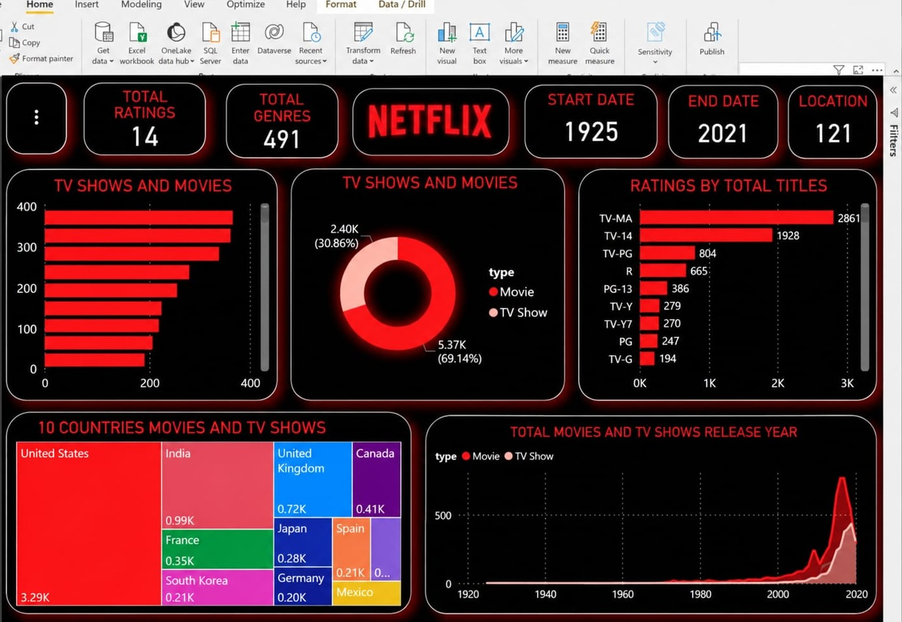

# SWYNEX-Data-Cleaning-Preparation

Task 1 submission for the **SWYNEX Technologies Virtual Internship**.

## Objective
The goal of this task is to clean and prepare a raw dataset for analysis by identifying and resolving missing values, duplicates, and incorrect data types.

## Dataset
I used the **Netflix Movies and TV Shows** dataset from Kaggle to perform real-world data cleaning.

## Files in this Repository
* `NetFlix.csv` : The raw, messy dataset.
* `cleaned_netflix_data.csv` : The final, analysis-ready dataset.
* `Data_Cleaning.ipynb` : The Google Colab notebook containing the Python code.

## Cleaning Steps Performed
1. **Removed Duplicates:** Dropped duplicate rows to ensure data accuracy.
2. **Handled Missing Values:** 
   * Filled missing text values in `director`, `cast`, and `country` with 'Unknown'.
   * Dropped rows with missing critical data (`date_added`, `rating`).
3. **Standardized Data Types:** Formatted messy string dates into proper Python DateTime objects.

**Tools Used:** Python, Pandas, Google Colab

# SWYNEX Technologies Virtual Internship

This repository contains my submissions for the **SWYNEX Technologies Data Analytics Virtual Internship**.

---

## 📂 Task 2: Exploratory Data Analysis (EDA) & Data Visualization

All files related to Task 2 are located inside the `Task2/` folder.

### 📌 Objective
Perform Exploratory Data Analysis (EDA) on the cleaned Netflix dataset using Python to calculate summary statistics, uncover trends, create visualization charts, and document key insights.

---

### 📁 Folder Contents (`Task2/`)
* **`Task2/task2_eda.ipynb`** : Google Colab notebook containing the complete Python code for EDA & Visualization.
* **`Task2/cleaned_netflix_data.csv`** : Cleaned dataset used for analysis.
* **`Task2/chart1_content_type.png`** : Pie chart showing Movies vs TV Shows distribution.
* **`Task2/chart2_yearly_trend.png`** : Line plot illustrating catalog growth over the years.
* **`Task2/chart3_top_countries.png`** : Bar chart of top content-producing countries.
* **`Task2/chart4_ratings.png`** : Bar chart displaying content rating distributions.

---

### 📊 Key Insights & Findings
1. **Content Type Dominance:** Movies account for **69.1%** (5,372 titles) of the Netflix library, while TV Shows make up **30.9%** (2,398 titles).
2. **Catalog Growth:** Platform expansion peaked between **2016 and 2019**, adding over **2,100 titles in 2019 alone**.
3. **Geographic Distribution:** The **United States** (2,546 titles) and **India** (923 titles) are the leading producers of content on Netflix.
4. **Target Demographic:** Over **60%** of the content is rated **TV-MA** or **TV-14**, showing a primary focus on mature and young-adult audiences.
5. **Top Genres:** **International Movies, Dramas, and Comedies** represent the highest volume of streaming content.

---

### 🛠️ Tools & Libraries Used
* **Language:** Python
* **Environment:** Google Colab
* **Libraries:** Pandas, Matplotlib, Seaborn

# SWYNEX - Task 3: Interactive Dashboard (Power BI)

This section contains my submission for **Task 3** of the **SWYNEX Technologies Virtual Internship**.

## 📌 Objective
The goal was to create an interactive dashboard using a BI tool (Power BI) to communicate the main findings from the cleaned Netflix dataset clearly, including KPIs, charts, and useful filters.

## 📁 Files in the `Powerbi` Folder
*   `pb1.png`: Dashboard layout focusing on overall content distribution and yearly trends.
*   `pb2.jpeg`: Dashboard layout featuring a global content distribution map and top genres/ratings.
*   `pb3.jpeg`: Dashboard layout highlighting a treemap of top countries and an area chart for release year trends.
*   *(Aapki Power BI file ka naam, e.g., `Netflix_Dashboard.pbix`)*

## 📊 Dashboard Previews

### Dashboard 1: Content & Trend Overview

### Dashboard 2: Global Reach & Demographics

### Dashboard 3: Release Trends & Top Countries Treemap

## 💡 Key Insights Visualized
1.  **Content Volume:** The platform hosts a total of 7,770 titles, with a strong dominance of Movies (69.14%) over TV Shows (30.86%).
2.  **Global Reach:** Content originates from 121 distinct countries, with the United States and India being the top contributors.
3.  **Audience Targeting:** The majority of content is rated TV-MA and TV-14, indicating a focus on mature audiences.
4.  **Growth Trend:** There was a significant spike in content added around 2017-2019, followed by a slight decline in 2020/2021.
